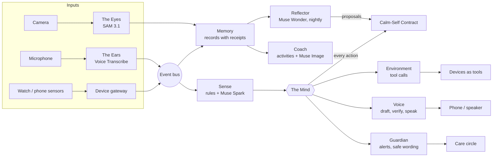

# Timber

**A no touch second brain for autistic adults and people living with dementia.** It notices when things are getting too much, steps in gently, speaks for you when your words switch off, remembers what really happened, and keeps your trusted people in the loop. It does all of that on rules you wrote while calm, so it never needs you to confirm anything in the hard moment.

Built by Patrick Charles for the **Meta Global AI Developer Hackathon** (Indie Developer · Build for Your World).

> I'm autistic. When I'm overstimulated, I lose my words. I've also watched elders live with dementia. I built Timber for both.

**Timber gives no medical advice.** It never diagnoses, names conditions or suggests treatment. It is daily-living support only, and every mood it shows is labelled as an estimate.

**Built during the hackathon (Oct 26 – Nov 4, 2026).** Two small pieces were adapted from my earlier prototype: the Bluetooth heart-rate reader on `/watch` and the Home Assistant wiring in `home.py`.

---

**This is Phase 1 of 5:** the brain. The [roadmap](#roadmap-this-is-phase-1) takes it to real smart devices, private on-device AI, your own voice, and a behind-the-ear wearable.

## The idea: the Calm-Self Proxy

AI agents usually stop and ask "are you sure?" Timber's person often can't answer at the critical moment. So Timber is built around four things:

1. **A Calm-Self Contract.** You write rules in plain words while calm ("Never tell strangers I'm autistic", "Text my trusted person as soon as it starts"). Muse Spark turns them into structured rules. Every action is checked against them, and each decision cites the rule that allowed it.
2. **Proof-carrying speech.** Every sentence Timber says carries a receipt (your own phrase, a record it heard, a photo) and is checked before it's spoken. Anything unproven is dropped. Timber never guesses what you think.
3. **The world as tools.** Nearby devices (lamp, speaker, thermostat, a store's quiet-zone light) register as tools. Timber finds them with tool search and uses them through Muse Spark tool calling. Walk out of range and they're gone.
4. **Sleep-time learning, with permission.** Each night Muse Wonder reviews the day and *proposes* playbook changes. Nothing changes until your calm self taps "Yes".

## Meta models: who does what

| Model | Role in Timber |
|---|---|
| **Muse Spark** `muse-spark-1.3` | The Mind and its agents: judges load against your baseline, calls device tools, drafts and verifies what Timber says, structures your rules, answers from memory |
| **Muse Voice Transcribe** `muse-voice-transcribe-1.0` | The Ears: live listening with speaker diarization, so Timber knows who is talking to you |
| **SAM 3.1** `sam-3.1` | The Eyes: "Where are my keys?" finds the object in a photo |
| **Muse Wonder** `muse-wonder-1.0` | The nightly review: care-circle summary, patterns, playbook proposals |
| **Muse Image** `muse-image-1.0` | Picture cards for memory activities, made ahead of time (and the brain on the console) |

Every model call has a demo-mode fallback, so the app runs without a key. Every call is also logged and shown live on the console under "Meta models at work".

## What it can do

**Autism mode**
- **Notices overload early** from heart rate, noise and movement, measured against *your* baseline. Rules answer instantly, and Muse Spark refines the judgement in the background.
- **Starts with a gentle vibration**, then a phone alert. It tells your trusted person right away, with an alert built from the live readings.
- **Calms the room.** Muse Spark picks which nearby tools to call (`set_brightness(percent=30)`, `pause()`), and puts everything back afterwards.
- **Speaks for you** when your words switch off: *"This is Timber, speaking for Patrick. Patrick can't talk right now, but he can hear you. Could you write it down or show him instead?"* Every sentence comes from your own phrases.
- **Fills the blank.** Stop mid-sentence ("can you pass the…") and the missing word appears on your phone.
- **Shows your progress:** episodes per day, average length, and which helps worked best.

**Dementia mode**
- **A calm voice first**, and bigger, simpler screens.
- **Morning orientation**, the same words every day, each part with a receipt: *"Good morning. It's Wednesday, November 4th. You're home. Maria visits at 6 this evening."*
- **Memory with receipts.** Ask "Timber, what did I say about my keys?" and it answers only from what it heard. If there's no record, it says so.
- **Where are my keys?** Take a photo. SAM 3.1 finds them, and Timber says *"on the wooden table, next to the blue bowl."*
- **Gentle brain activities** built from your own memories, with Muse Image picture cards. The answer is shown first, then the gaps grow (spaced retrieval).

**For the care circle**
- Live alerts, episodes per day, and mood during each episode (always an estimate).
- The nightly summary.

## How Timber connects to your devices

Timber sits in the middle. **Senses** come in from the things you wear and carry, and Timber **acts** through the devices around you. Every device becomes a **tool** that Muse Spark can find and call.

### Senses in: what Timber listens to

| Device | How it connects |
|---|---|
| **Smartwatch or heart-rate strap** | Standard **Bluetooth heart-rate service**, read with Web Bluetooth in Chrome or Edge on `/watch`. Works with straps and watches that broadcast heart rate. Readings go to Timber every 2 seconds. |
| **Any sensor, app or hub** | One web request: `POST /api/devices/ingest` with `{"device": "...", "metric": "heart_rate", "value": 92}`. It understands common names (`hr`, `pulse`, `noise`, `db`, `motion`…) and drops impossible values, such as a strap that lost contact. A phone sound meter, a Raspberry Pi sensor or a Home Assistant automation can all feed it. |
| **Microphone** | The browser streams 24 kHz audio over a websocket to Timber's server, which relays it to **Muse Voice Transcribe**. Speaker diarization tells your voice from other people's. The API key never leaves the server. |
| **Phone camera** | A photo plus "Where are my keys?" goes to **SAM 3.1**, which finds the object. The sighting is saved to memory with the photo as its receipt. |

### Hands out: what Timber can act on

| Device | How it connects |
|---|---|
| **Smart lights, speakers, thermostats** | Through **Home Assistant**, which supports most smart-home brands. Set `HA_URL`, `HA_TOKEN` and your entity IDs in `.env`. Timber calls Home Assistant's services: `light.turn_on` with a brightness, `media_player.media_pause` and `volume_set`, and `climate.set_temperature`. Without Home Assistant, a simulated home shows the same actions on screen. |
| **Devices that come and go** | Any device can announce itself with `POST /api/devices/register`: its name, kind, room, the actions it offers, and how long it stays (`ttl_s`). It becomes a Muse Spark tool straight away and disappears when it leaves range. That's how a store's quiet-zone light shows up when you walk in. Timber never carries a fixed device list; the Mind uses **tool search** to find what's nearby right now. |
| **Your phone** | The `/person` web app stays connected over a websocket. It gives a gentle vibration (Vibration API on Android; a soft on-screen pulse on iPhone), banners, the missing word and Timber's replies, and can speak out loud. |
| **Your trusted people** | `/circle` gets live alerts over a websocket the moment overload starts, plus the nightly summary. |

**One example, end to end:** your watch's heart rate and the room's noise climb above your baseline.
1. Timber vibrates your phone and alerts your trusted person.
2. It searches for nearby calming tools and finds the store's light and music.
3. Muse Spark calls `set_brightness(percent=30)` and `pause()`.
4. When you're calm, Timber puts everything back.

**In the demo video**, the watch readings and devices are simulated so the story is repeatable. The Bluetooth reader, the ingest API, device registration and the Home Assistant connection are all real code paths in this repo.

## Screens

| Page | For |
|---|---|
| `/console` | The demo view: Patrick's state, the world wired to Timber, live decisions and Meta model calls. **▶ Play the live story** runs the whole store scenario in about 75 seconds. |
| `/person` | The person's phone: state, vibration, alerts, what Timber said, the missing word, Ask Timber, Find something, progress, activities |
| `/contract` | Write rules in your own words, switch Autism/Dementia mode, approve the nightly proposals |
| `/circle` | Family and partners: alerts, the daily summary, episodes and trend |
| `/listen` | Live listening: who said what, tag your own voice, hear Timber's replies |
| `/watch` | Connect a Bluetooth heart-rate watch, or simulate readings; see the home devices |

## Architecture



Every input becomes an event on one bus. The Mind makes one decision at a time, using the least intrusive help first, and checks the contract before each one. Specialist agents carry the decisions out. See [ARCHITECTURE.md](ARCHITECTURE.md) for the full plan.

**Stack:** Python, FastAPI, websockets, SQLite. Plain HTML/JS apps, no build step.

## Run it

You need Python 3.11+. A Meta Model API key is optional; without one, Timber runs in demo mode.

```bash
git clone https://github.com/Pchar046/timber.git
cd timber
python -m pip install -r requirements.txt
cp .env.example .env          # then put your key after MODEL_API_KEY= (optional)
python -m uvicorn backend.main:app --host 0.0.0.0
```

On Windows, use `py` instead of `python`, and `copy` instead of `cp`.

Then open:
- **http://127.0.0.1:8000/console** and press **▶ Play the live story**
- **http://<your computer's IP>:8000/person** on your phone, on the same Wi-Fi

**Try it without a microphone or devices** (run these while the server is running):

| Script | What it shows |
|---|---|
| `python scripts/scenario.py` | The store story from the command line: rising load, decisions, Timber speaking for you |
| `python scripts/fill_test.py` | Fill the blank |
| `python scripts/memory_test.py` | Answers from memory, with receipts |
| `python scripts/find_test.py photo.jpg` | SAM 3.1 finds your keys in a photo |
| `python scripts/test_models.py` | Checks every Meta model with your key |

**Optional settings in `.env`:**
- Home Assistant (`HA_URL`, `HA_TOKEN`), to drive real lights and speakers.
- The times for the nightly review, morning orientation and practice.

See `.env.example` for all of them.

## What's real and what's simulated

- **Real:** every decision, sentence, check, tool call, memory answer, photo search and nightly review runs live on Meta models (with a key). Live listening uses Muse Voice Transcribe on a real microphone, and a real Bluetooth heart-rate watch works on `/watch`.
- **Simulated in the demo story:**
  - the body signals (heart rate, noise, movement);
  - the cashier's question, sent as text;
  - the home and store devices (without Home Assistant);
  - the keys photo, made with Muse Image.

  The console says so on screen.
- **Placeholders:** "Trusted person" and "Maria" are example names in `data/`.

## Roadmap: this is Phase 1

What's in this repo is **Phase 1: the brain.** It's the software that senses, decides, speaks with proof, remembers and learns with permission, running on five Meta models. A smart-devices prototype is already in the works. With more time, the next four phases are:

| Phase | What it adds | Meta models |
|---|---|---|
| **1. The brain** *(built during this hackathon)* | The Mind and its agents, the Calm-Self Contract, proof-carrying speech, devices as tools, memory, the nightly review, Autism and Dementia modes, the apps and console | Muse Spark, Muse Wonder, Voice Transcribe, SAM 3.1, Muse Image |
| **2. Real smart devices** *(in the works)* | Timber running a real home through Home Assistant (lights, speakers, thermostat) and real wearables all day. Shops, offices and venues can offer a "quiet tool" (a dimmable light, quieter music) that Timber finds as you walk in. | Muse Spark tool calling |
| **3. Private and offline** | A guardian on a home hub that filters sensitive audio before anything leaves the house, and keeps the core loop working with no internet | Muse Glimmer (open weights, on device) |
| **4. Your own voice** | Speak-for-me in a voice that sounds like you, from a model tuned on your own phrases, which only you approve | Muse Spark Open (open weights, fine-tuned) |
| **5. Behind the ear** | The no-touch wearable Timber was designed for: a small device behind the ear with a microphone, gentle haptics and a quiet speaker, so it helps without anyone needing to hold a phone. Pilots with autistic adults, families and care partners. | All of the above |

Every phase keeps the same rules: no medical advice, every fact with a receipt, and nothing changes without the person's calm-self approval.

## Privacy and safety

- The API key stays on Timber's server. The browser never sees it, and audio is relayed through the backend.
- Medical words are blocked in everything sent out, and never-say rules apply to everything Timber says.
- Data is stored locally in SQLite (`data/timber.db`, not committed).
- Care-circle messages are written about the person, kindly, and only from real readings.

## Project layout

```
backend/
  main.py          FastAPI app
  demo.py          console feed + the store story
  meta/            one client per Meta model, with demo fallbacks and a call log
  core/            event bus, state + baseline, profile, modes, contract, storage
  agents/          mind, sense, guardian, environment, voice, fill, memory, find, coach, reflector
  devices/         device gateway, home devices as tools, live listening relay
apps/              console, person, contract, circle, listen, watch (static pages)
data/              profile, contract, schedule, demo photo
scripts/           scenario and test scripts
```
